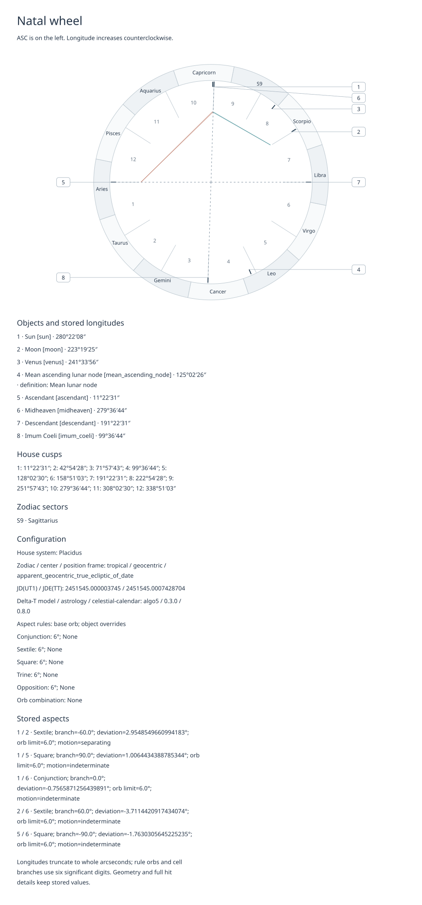
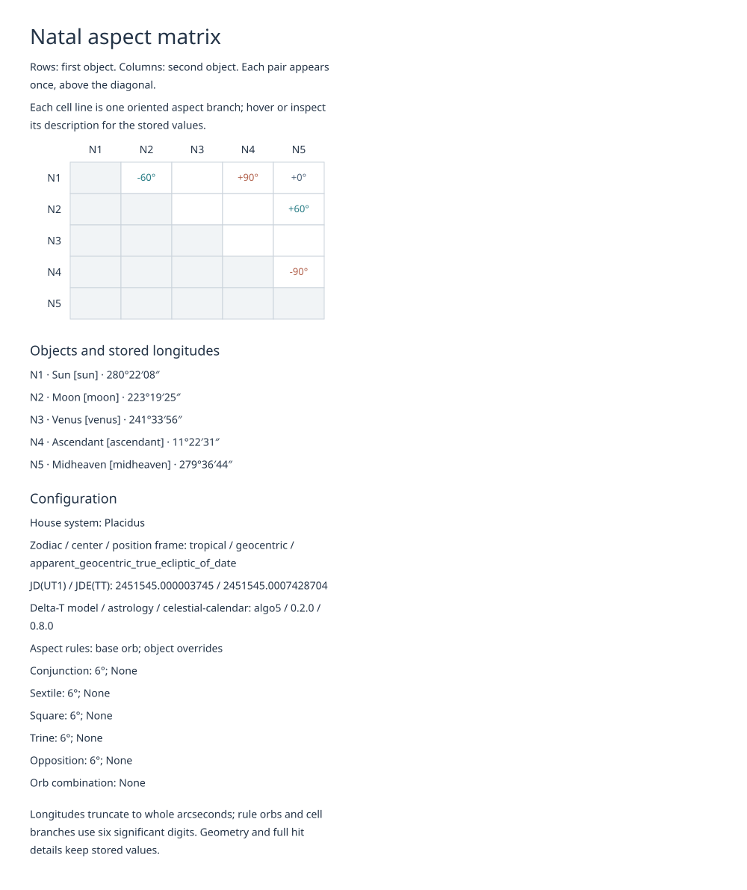
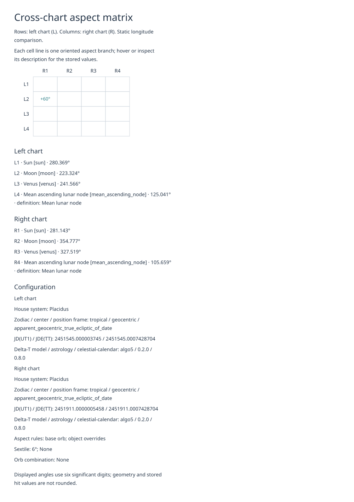

# SVG wheels and aspect matrices

[简体中文](../zh-CN/svg.md) · [Chart results](records.md) · [API](reference.md)

Pass a chart and a loaded catalog to `render_natal_wheel` or `render_natal_matrix`.
For two charts, first choose comparison rules with `cross_chart_aspects`, then
pass its result to `render_cross_matrix`. Each renderer returns an SVG string;
only your own file-writing code saves it.

## Render and save

These synthetic birth records use UTC and an explicit location. The second chart
uses the same configuration but a different year.

```{doctest}
>>> from datetime import date, time, timedelta
>>> from xml.etree import ElementTree as ET
>>> from astrology import (AspectRule, Axis, BirthRecord, Body, ChartConfig,
...   FixedOffset, HouseSystem, Location, LunarNode, MajorAspect,
...   cross_chart_aspects, load_catalog, natal_chart, prepare_natal_input,
...   render_cross_matrix, render_natal_matrix, render_natal_wheel)
>>> record = BirthRecord(date(2000, 1, 1), time(12), FixedOffset(timedelta(0)), Location(0, 0))
>>> config = ChartConfig(HouseSystem.PLACIDUS,
...   (Body.SUN, Body.MOON, Body.VENUS, LunarNode.MEAN_ASCENDING),
...   tuple(AspectRule(a, 6) for a in MajorAspect),
...   aspect_objects=(Body.SUN, Body.MOON, Body.VENUS, Axis.ASCENDANT, Axis.MIDHEAVEN))
>>> chart = natal_chart(prepare_natal_input(record), config)
>>> from dataclasses import replace
>>> other = natal_chart(prepare_natal_input(replace(record, birth_date=date(2001, 1, 1))), config)
>>> comparison = cross_chart_aspects(chart, other, (AspectRule(MajorAspect.SEXTILE, 6),))
>>> catalog = load_catalog()
>>> wheel = render_natal_wheel(chart, catalog, language="en")
>>> matrix = render_natal_matrix(chart, catalog, language="en")
>>> cross_matrix = render_cross_matrix(comparison, catalog, language="en")
>>> all(isinstance(value, str) for value in (wheel, matrix, cross_matrix))
True
>>> roots = [ET.fromstring(value) for value in (wheel, matrix, cross_matrix)]
>>> [root.get("width") for root in roots]
['1000', '1000', '1000']
>>> all(root.get("viewBox") == f"0 0 {root.get('width')} {root.get('height')}" for root in roots)
True
```

Save, for example, the returned wheel with ordinary Python file I/O:

```python
from pathlib import Path

Path("natal.svg").write_text(wheel, encoding="utf-8")
```

Use `language="zh-CN"` for Chinese. All three functions default to `"en"`.
Rendering itself does not load a catalog, calculate positions, resolve timezones,
access files or the network, or modify the supplied results.

## Read the figures

The wheel puts the actual Ascendant on the left; longitude increases
counterclockwise. It draws all stored bodies/nodes and all four actual axes,
including objects not selected for aspects. House spokes use the actual cusps;
MC need not be the top of the page or the tenth cusp. Labels move to numbered
callouts with leaders; position ticks and chord endpoints keep unrounded angles.
The key gives each identity, its longitude and each node's definition. Long sign
names use `S1` through `S12` with a full-name key.
House numbers that would overlap on the wheel are omitted there; the cusp key
always lists all twelve house numbers and longitudes.

The natal matrix follows `chart.effective.aspect_objects`. Rows are the first
objects and columns the second objects; each pair appears once above the diagonal.
Participants without hits remain visible. No aspect rules means no participants.
The cross matrix follows `comparison.left_objects` in rows (`L`) and
`right_objects` in columns (`R`); the two Suns remain separate. An empty selection
leaves that side empty. Cross-chart node pairs are retained; within one natal
chart, nodes do not pair with each other.

Each cell line gives one signed aspect branch in degrees. Multiple matches and
both branches are retained even with wide orbs. Hover over a line or read its SVG
`title` for the aspect name, full stored deviation and orb limit; natal descriptions
also retain motion. Static cross-chart results never infer motion. Wheel chords
use only `chart.aspects`, and the cross matrix uses the comparison's rules, not
the source charts' natal rules. Configuration sections name the house systems,
coordinate identifiers, model/version labels and aspect/orb choices.

### English samples

Open the SVG itself to inspect it at its natural size. These samples use the
records and calls above; their source notes are not printed.







## Size, fonts and errors

The wheel is 1000 CSS pixels wide. Matrices have a minimum width of 1000 pixels
and grow by 68 pixels per column after the row header and margins exceed it.
Cell height grows to retain every hit; wrapped keys/configuration grow the figure
height. There is no size or theme parameter. Inspect the root `width`, `height`
and `viewBox` for the actual natural dimensions. Scaling down in a page also
shrinks text; inspect at 1:1 before printing or embedding.

The font chain is `Noto Sans, Noto Sans CJK SC, sans-serif`. The SVG bundles no
font or remote resource, and uses ordinary text instead of astrology glyphs.
Chinese needs a local CJK-capable fallback. Layout uses conservative Unicode
budgets; recipient font metrics and pixel output can differ across viewers.

Wrong concrete chart/comparison/catalog types raise `TypeError`. Invalid language,
missing/stale translations, ambiguous or missing identity bindings and XML 1.0
invalid text raise `ValueError`; a missing sign ID raises `KeyError`. There is no
English fallback. XML-special characters remain text; XML-valid nonprinting
characters display as escapes such as `\n`. Invalid XML characters are rejected
before that transformation. Names must be current only when used by the figure.
SVG output is a presentation, not a chart save/restore format. It includes model
labels and calculation instants, but not the birth record's source mappings or notes.
