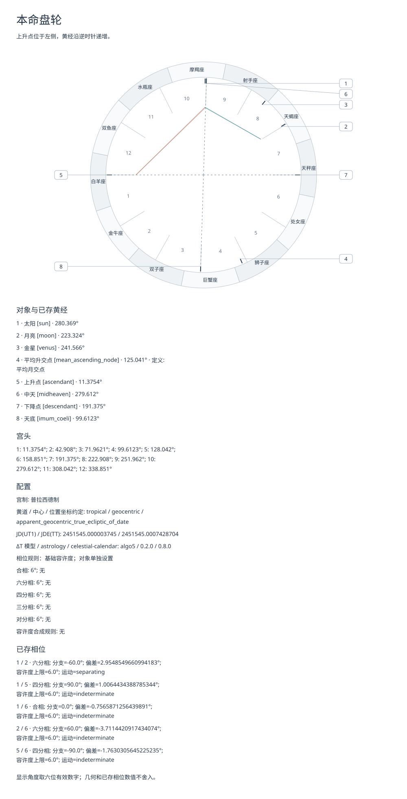
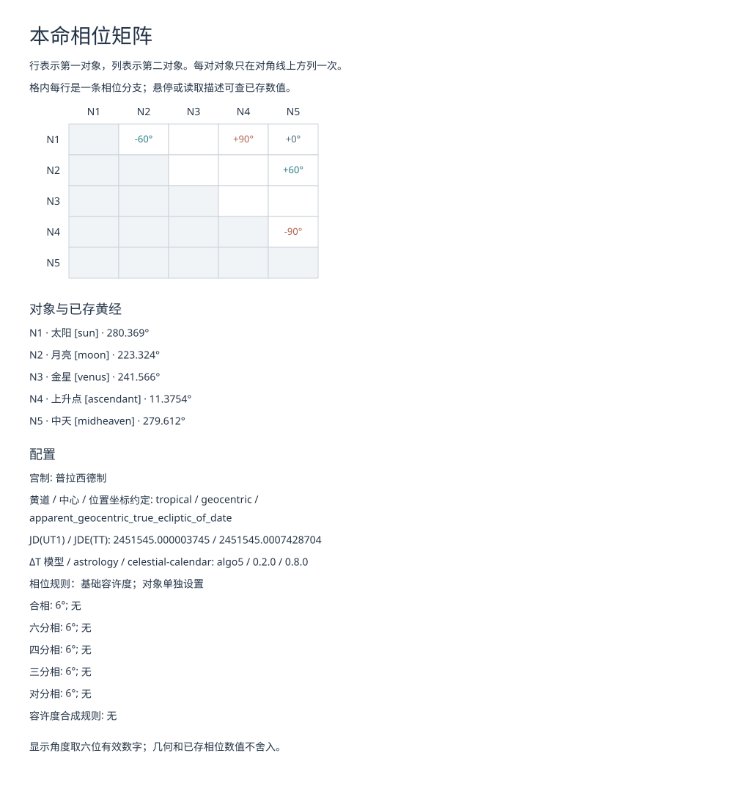
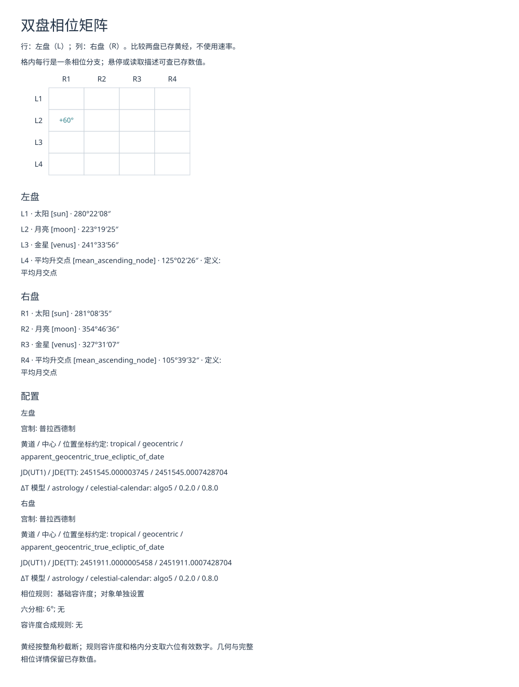

# SVG 轮盘与相位矩阵

[English](../en/svg.md) · [命盘结果](records.md) · [API](reference.md)

把命盘和已加载的 catalog 传给 `render_natal_wheel` 或 `render_natal_matrix`，即可生成轮盘或本命矩阵。
比较两盘时，先用 `cross_chart_aspects` 指定比较规则，再把结果传给 `render_cross_matrix`。
三个函数都返回 SVG 字符串；保存文件由调用方完成。

## 生成与保存

下面的合成出生记录使用 UTC，并显式给出地点。第二张盘沿用配置，但改用另一年。

```{doctest}
>>> from datetime import date, time, timedelta
>>> from xml.etree import ElementTree as ET
>>> from astrology import (AspectRule, Axis, BirthRecord, Body, ChartConfig,
...   FixedOffset, HouseSystem, Location, LunarNode, MajorAspect,
...   cross_chart_aspects, load_catalog, natal_chart, prepare_natal_input,
...   render_cross_matrix, render_natal_matrix, render_natal_wheel)
>>> record = BirthRecord(date(2000, 1, 1), time(12), FixedOffset(timedelta(0)), Location(0, 0))
>>> config = ChartConfig(HouseSystem.PLACIDUS,
...   (Body.SUN, Body.MOON, Body.VENUS, LunarNode.MEAN_ASCENDING),
...   tuple(AspectRule(a, 6) for a in MajorAspect),
...   aspect_objects=(Body.SUN, Body.MOON, Body.VENUS, Axis.ASCENDANT, Axis.MIDHEAVEN))
>>> chart = natal_chart(prepare_natal_input(record), config)
>>> from dataclasses import replace
>>> other = natal_chart(prepare_natal_input(replace(record, birth_date=date(2001, 1, 1))), config)
>>> comparison = cross_chart_aspects(chart, other, (AspectRule(MajorAspect.SEXTILE, 6),))
>>> catalog = load_catalog()
>>> wheel = render_natal_wheel(chart, catalog, language="zh-CN")
>>> matrix = render_natal_matrix(chart, catalog, language="zh-CN")
>>> cross_matrix = render_cross_matrix(comparison, catalog, language="zh-CN")
>>> all(isinstance(value, str) for value in (wheel, matrix, cross_matrix))
True
>>> roots = [ET.fromstring(value) for value in (wheel, matrix, cross_matrix)]
>>> [root.get("width") for root in roots]
['1000', '1000', '1000']
>>> all(root.get("viewBox") == f"0 0 {root.get('width')} {root.get('height')}" for root in roots)
True
```

例如，用普通 Python 文件 I/O 保存返回的轮盘：

```python
from pathlib import Path

Path("natal.svg").write_text(wheel, encoding="utf-8")
```

英文使用 `language="en"`，三个函数也都默认使用英文。生成 SVG 本身不加载 catalog、计算位置、
解析时区、读写文件或访问网络，也不修改传入的结果。

## 怎样读图

轮盘把实际上升点放在左侧，黄经沿逆时针递增。全部已存天体、交点和实际四轴都会画出，
未选择参与相位的对象也保留。宫线使用实际宫头；中天不必位于页面正上方，也不必等于十宫宫头。
编号标签可以避让，用引线连接真实位置；位置刻度和相位端点仍用未舍入角度。
索引列出对象标识、黄经及交点的具体定义。较长的星座名改用 `S1` 至 `S12`，并在索引中列全名。
轮盘上会重叠的宫位数字不再就地标注；宫头索引始终列出十二宫的编号和黄经。

本命矩阵按 `chart.effective.aspect_objects` 排列，行是第一对象、列是第二对象，每对对象只在
对角线上方出现一次。没有命中的参与对象仍保留；没有相位规则时，参与对象也为空。
双盘矩阵的行按 `comparison.left_objects` 排列（`L`），列按 `right_objects` 排列（`R`），
两盘太阳不会合并。某侧选择为空时，该侧保持为空。跨盘的交点配对会保留；同一本命盘的交点之间不配对。

格内每行是一个带符号的相位分支，单位为度。即使容许度很宽，多种相位和两个分支也都保留。
悬停在分支上，或读取 SVG 的 `title`，可查相位名、完整的已存偏差和容许度上限；
本命描述还保留运动状态。静态双盘结果不推断运动。轮盘连线只使用 `chart.aspects`；
双盘矩阵使用本次比较的规则，不使用源盘的本命规则。配置区说明宫制、坐标标识、
模型及版本标签，以及相位和容许度选择。

### 中文样图

打开 SVG 文件本身，可按自然尺寸查看。这些样图使用上面的记录和调用，不打印记录的来源备注。







## 尺寸、字体与错误

轮盘宽 1000 CSS 像素。矩阵最小宽度为 1000 像素；行标题及边距之外，每列占 68 像素，
所需宽度超过最小值时增宽。格子按命中数增高，索引和配置换行后也会增加图高。
接口没有尺寸或主题参数。根元素的 `width`、`height` 和 `viewBox` 给出实际自然尺寸。
在页面中缩小图片也会缩小文字；嵌入或打印前应按 1:1 查看。

字体链为 `Noto Sans, Noto Sans CJK SC, sans-serif`。SVG 不附带字体或远程资源，
使用普通文字，不依赖特殊占星字形；中文需要本地有支持 CJK 的后备字体。
布局按保守的 Unicode 字宽预算安排，接收者的字体度量和查看器像素输出可能不同。

命盘、比较结果或 catalog 的具体类型错误时抛 `TypeError`。语言无效、译文缺失或陈旧、
对象名称绑定缺失或不唯一，以及文字含 XML 1.0 禁止字符时，抛 `ValueError`；缺少星座 ID 时
抛 `KeyError`，不会回退到英文。XML 特殊字符作为文字显示；XML 允许的不可打印字符显示为
`\n` 等转义形式，XML 禁止字符在该转换之前就会被拒绝。只有图中实际使用的名称需要为当前版本。
SVG 是显示结果，不是命盘保存或恢复格式。它包含模型标签和计算时刻，不包含出生记录的来源映射或备注。
